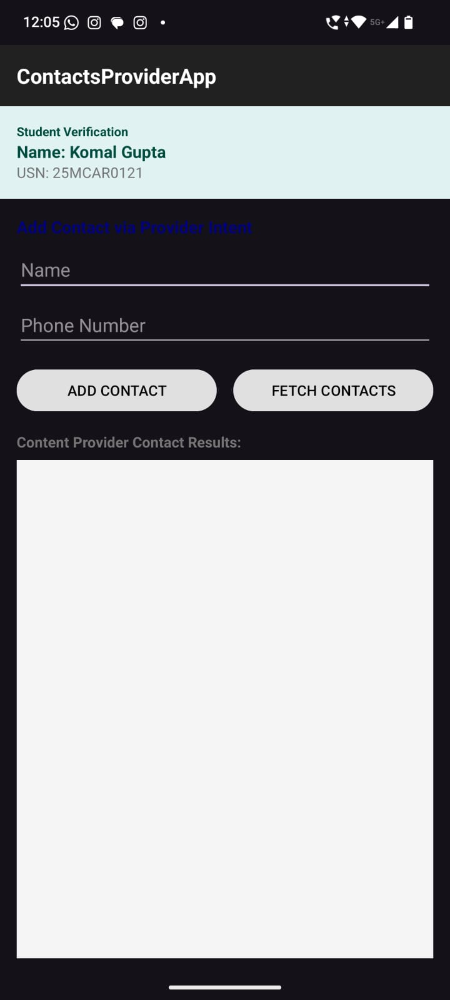
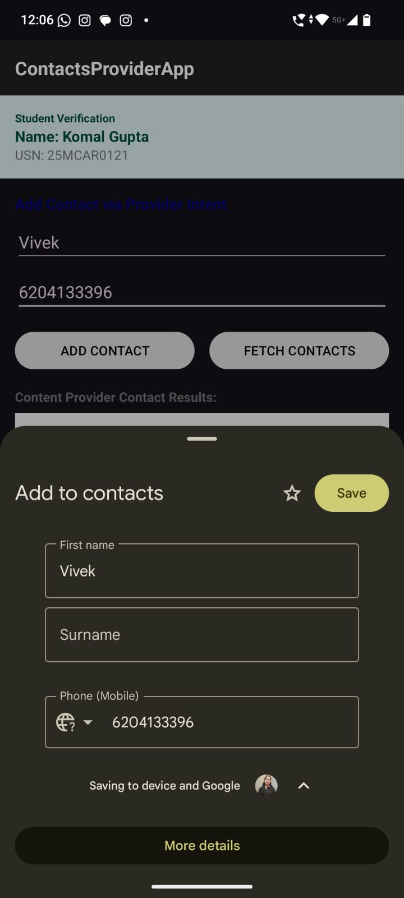
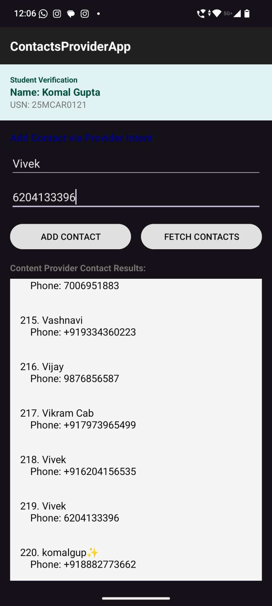

# Experiment 10: Data Sharing Using Contacts Content Provider

## 📌 Experiment Title
**Develop an Android application that demonstrates data sharing using the Contacts Content Provider.**

## 🎯 Aim
To develop an Android application that accesses and displays contact information using the Android Contacts Content Provider and allows users to add contacts through the system's contact application.

## 🛠️ Technologies Used
- Android Studio
- Kotlin
- XML
- Android SDK
- Contacts Content Provider
- ContentResolver
- Android Intents
- Runtime Permissions

## 📱 Application Name
**ContactsProviderApp**

## ✨ Features

### 1. Student Verification
Displays the student verification section containing the student's name and USN.

### 2. Add Contact via Provider Intent
Allows the user to enter a contact name and phone number and open the system Contacts application to save the contact.

### 3. Fetch Contacts
Retrieves contact information from the device using the Contacts Content Provider and displays the available contact names and phone numbers.

### 4. ContentResolver
Uses Android's `ContentResolver` to communicate with the Contacts Content Provider and query contact data.

### 5. Runtime Permission
Requires the appropriate contacts permission before reading contact information from the device.

## 📸 Application Screenshots

### 1. Application Home Screen
The home screen contains the student verification section, name and phone number fields, Add Contact and Fetch Contacts buttons, and the contact results area.

---

### 2. Add Contact Using Provider Intent
The system Contacts application opens with the entered name and phone number, allowing the user to save the contact.

---

### 3. Fetched Contacts
The application displays contact names and phone numbers retrieved from the Contacts Content Provider.

---

## ⚙️ Main Components

| Component | Purpose |
|---|---|
| `MainActivity.kt` | Handles application logic and user interactions |
| `activity_main.xml` | Defines the user interface |
| `ContentResolver` | Queries contact information |
| `ContactsContract` | Provides access to contact data and phone numbers |
| `Intent` | Opens the system Contacts application |
| `Cursor` | Reads the results returned by a query |

## 🔄 Working Procedure
1. Launch the application.
2. Enter the contact name and phone number.
3. Select **Add Contact** to open the system Contacts application and save the contact.
4. Grant contacts permission when requested.
5. Select **Fetch Contacts** to retrieve available contacts.
6. View the contact names and phone numbers in the results section.

## 🔐 Permission
The application requires the following permission to read contacts:

`android.permission.READ_CONTACTS`

The permission must be declared in `AndroidManifest.xml` and granted by the user at runtime where required.

## ✅ Result
The Android application demonstrates data sharing using the Contacts Content Provider. It allows the user to add a contact through an Android intent and retrieve available contact names and phone numbers using `ContentResolver`.

## 👩‍💻 Conclusion
This experiment explains how Android applications can access shared contact data through Content Providers. It demonstrates the use of `ContentResolver`, `ContactsContract`, intents, and runtime permissions for contact management.

---

**Experiment:** 10  
**Application:** ContactsProviderApp
